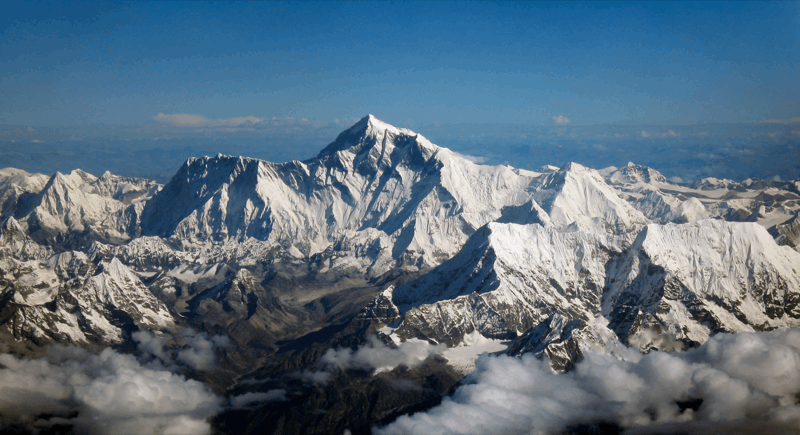

# OptiImg

🇬🇧 **English** · 🇻🇳 [Tiếng Việt](README.vi.md)

**Compress a whole folder of images with one command — offline, on your own machine.**

OptiImg is a command-line image compressor. Run `optiimg` in a folder and it shrinks every PNG, JPEG, WebP, AVIF and
JPEG XL inside by roughly **70–80%**, overwriting the files in place, with differences that are hard to see by eye.
Nothing is uploaded anywhere.

## Real result

Same image, before and after `optiimg` (800×435 PNG, nothing else changed):

| Original — **610 KB** | After OptiImg — **189 KB (−69%)** |
|---|---|
|  |  |

The compressed PNG uses a 256-colour palette chosen by OptiImg's own quantiser (SSIM 0.983, PSNR 39 dB against the
original). Both files are in [`docs/images/`](docs/images/) so you can compare them at full size.

A full run on 13 real test images (4K and 8K photos, log-profile and 16-bit PNGs, a transparent logo) on an Apple Silicon
MacBook:

```console
$ optiimg -y --lang en ./samples
Found 13 images (210.0 MB) in ./samples
Using 4 workers.

[ 1/13]  4k.jpg         1.2 MB → 85 KB    (saved 1.1 MB, -93%)   1.0s
[ 4/13]  4k_detail.png  16.8 MB → 3.7 MB  (saved 13.1 MB, -78%)  2.7s
[ 8/13]  8k.jpg         26.6 MB → 6.0 MB  (saved 20.6 MB, -77%)  5.8s
[10/13]  8k.png         92.1 MB → 22.2 MB (saved 69.8 MB, -76%)  8.7s
  …
Done: 13 compressed, 0 already optimal, 0 failed
Size: 210.0 MB → 43.3 MB  (saved 166.6 MB, -79.4%)
Time: 13s total (2.5s average per image, 33s summed over images)
Slowest: 8k.png (8.7s)
Peak process memory ≈ 1.8 GB
```

| Image | Before | After | Saved | Time |
|---|---|---|---|---|
| 4K JPEG, detailed | 3.3 MB | 1.1 MB | 68% | 1.2 s |
| 4K PNG | 10.4 MB | 2.5 MB | 76% | 2.9 s |
| 4K 16-bit PNG | 32.7 MB | 3.0 MB | 91% | 2.0 s |
| 8K JPEG (50 MP) | 26.6 MB | 6.0 MB | 77% | 5.8 s |
| 8K PNG (50 MP) | 92.1 MB | 22.2 MB | 76% | 8.7 s |
| Transparent PNG logo | 11 KB | 4 KB | 67% | < 0.1 s |

Savings depend on the picture: skies and flat areas shrink a lot, very detailed images less.

## Features

- **Offline and private.** No server, no account, no upload. A single binary for macOS, Linux and Windows (amd64 and arm64).
- **One command for a whole folder.** Scans subfolders too, shows what it found, asks before touching anything.
- **Quality-driven, not a fixed setting.** For every image OptiImg searches the smallest file that still meets a visual
  similarity target (SSIM 0.98 by default), so simple images get compressed hard and complex ones are protected.
- **PNG:** reduced to at most 256 colours with a custom quantiser (median cut + k-means + dithering), transparency kept.
  `--max` squeezes about 9% more with Zopfli.
- **JPEG:** re-encoded with jpegli (progressive, 4:2:0). Phone photos are rotated correctly. Very large photos use a
  low-memory mode.
- **WebP, AVIF, JPEG XL:** compressed in place as well, or produced from your PNG/JPEG with `--format`.
- **Safe by design:**
  - never writes a file larger than the original;
  - writes to a temp file and renames it, so a crash or power cut never leaves a broken image;
  - marks processed files so running again does not compress them twice;
  - Ctrl+C once waits for the current files, twice stops immediately without leaving temp files.
- **Keeps colours right.** Wide-gamut colour profiles (e.g. Display P3 from iPhones) are preserved in PNG/JPEG; other
  metadata (EXIF, GPS, thumbnails) is removed to save space.
- **Gentle on your machine.** At most 4 workers by default, a 2 GB memory budget, and a lowered process priority.
- **Clear output** in Vietnamese or English (`--lang en`): size before/after, bytes saved and time per file, plus a summary.

## Install

**Download a binary (recommended).** On the repository's **Releases** page, download the file for your machine:

| Machine | File |
|---|---|
| Apple Silicon Mac (M1/M2/…) | `optiimg_<version>_darwin_arm64.tar.gz` |
| Intel Mac | `optiimg_<version>_darwin_amd64.tar.gz` |
| Linux | `optiimg_<version>_linux_amd64.tar.gz` or `_arm64` |
| Windows | `optiimg_<version>_windows_amd64.zip` or `_arm64` |

```sh
tar -xzf optiimg_*_darwin_arm64.tar.gz
sudo mv optiimg /usr/local/bin/      # or any folder on your PATH
optiimg --version
```

- **macOS:** the binary is not signed. If macOS blocks it on first run:
  `xattr -d com.apple.quarantine /usr/local/bin/optiimg`.
- **Windows:** unzip `optiimg.exe` and put it in a folder on your `PATH`.
- **Private repository:** sign in to GitHub first; from a terminal you can use
  `gh release download <tag> -p '*darwin_arm64*'`.
- Optional integrity check: `shasum -a 256 -c checksums.txt`.

**Or build from source** (Go ≥ 1.27): `git clone https://github.com/vanh6803/OptiImg.git && cd OptiImg && make install`.

## Usage

> **Images are overwritten in place and this cannot be undone.** Preview with `optiimg -n` and keep a backup of anything
> important before your first run.

```sh
optiimg                    # current folder and subfolders: scan, confirm, compress
optiimg ~/Pictures/trip    # another folder
optiimg -n                 # dry run: list what would be processed, change nothing
optiimg -y                 # no confirmation prompt (scripts)
optiimg -y -j 2            # only 2 workers: lighter on the machine
optiimg --lang en          # English messages (or set OPTIIMG_LANG=en)
optiimg --format webp      # create .webp next to each PNG/JPEG (also avif, jxl, jpg, png)
optiimg --max              # PNG: extra ~9% with Zopfli, much slower
```

A safe first run:

```sh
optiimg -n                       # 1. see which files would be touched
cp -R ./photos ./photos-backup   # 2. back up
optiimg                          # 3. compress
```

### Options

| Option | What it does |
|---|---|
| `-y`, `--yes` | Skip the `[y/N]` prompt. Without it, OptiImg refuses to run when stdin is not a terminal. |
| `-n`, `--dry-run` | List the images that would be processed; write nothing. |
| `--no-recursive` | Only the given folder, not its subfolders. |
| `-j`, `--jobs N` | Images processed in parallel. Default: half the CPU cores, at most 4. |
| `--max-mem MB` | Memory budget for parallel work (default 2048). Lower it on machines with little RAM. |
| `--min-ssim S` | Quality target 0–1 (default 0.98). Higher = better looking, bigger files. |
| `--lossless` | No quality loss (PNG keeps all colours; WebP/AVIF/JXL use lossless mode). |
| `--max` | PNG about 9% smaller with Zopfli, 10–100× slower. |
| `--format F` | Convert to `webp`, `avif`, `jxl`, `jpg` or `png`. A new file is written next to the original; existing files are never overwritten and a result that is not smaller is not written. The original is kept and marked as done. |
| `--delete-original` | With `--format`: delete the original once the new file is written. |
| `--strip-icc` | Also drop wide-gamut colour profiles (kept by default so colours do not shift). |
| `--force` | Process again files already marked as compressed. |
| `--keep-mtime` | Keep each file's modification time. |
| `--include png,jpg` | Only these extensions (default: png, jpg, jpeg, webp, avif, jxl). |
| `--exclude PATTERN` | Skip matching paths, e.g. `--exclude 'raw/*'` (repeatable). |
| `--lang vi\|en` | Message language (default `vi`; or `OPTIIMG_LANG=en`). |
| `--json` | One JSON line per file plus a final summary line, for scripts. |
| `-q`, `--quiet` | Only the final summary. |
| `--version` | Print the version. |

Exit codes: `0` all good · `1` at least one file failed · `2` bad options or not confirmed.

Skipped automatically: hidden folders (`.git`…), `node_modules`, `vendor`, symlinks, read-only files, animated images,
and files in formats OptiImg does not handle.

## Limitations

- **Formats:** PNG, JPEG, WebP, AVIF and JPEG XL only. RAW files (CR2, DNG, ARW…), GIF, HEIC and animated images are
  skipped and left untouched. Lossless WebP is also skipped, because the WebP decoder used converts to 4:2:0 and would
  degrade it. Animated JPEG XL is not detected yet, so do not run OptiImg on folders that contain them.
- **Converting formats is mostly for compatibility.** At the same quality target, WebP/AVIF/JPEG XL files came out between
  about 11% smaller (JPEG XL) and 6% larger (AVIF) than OptiImg's own JPEG output on our test photos; do not expect
  large extra savings from `--format`.
- **Speed:** AVIF and JPEG XL encode slower than JPEG (roughly 6–9 s for a 4K photo, WebP about 2 s).
- **Memory:** images up to 100 megapixels. A 50 MP photo needs about 0.9–1.3 GB of RAM; use `--max-mem` and `-j 1` on
  small machines. JPEGs above 16 MP use a low-memory mode that makes them 5–40% larger than they could be.
- **Colour profiles** are preserved only when the output is PNG or JPEG; converting to WebP/AVIF/JPEG XL drops them
  (reported as `icc_profile_dropped` in `--json`).
- **"Already compressed" marks** are stored as file extended attributes. On file systems without them (some FAT/exFAT
  drives, network shares) a re-run may compress images again; OptiImg warns once. Cloud sync tools may also drop the mark.
- **Quality numbers in `--json`** for photos above 4 MP describe a sample of the image used for the quality search, not
  the whole image.
- **The binary is unsigned:** macOS needs the `xattr` command above on first launch.

See [CHANGELOG.md](CHANGELOG.md) for what changed in each version.

Sample image: "Mount Everest as seen from Drukair2" (Wikimedia Commons, CC BY-SA 2.0), resized.
