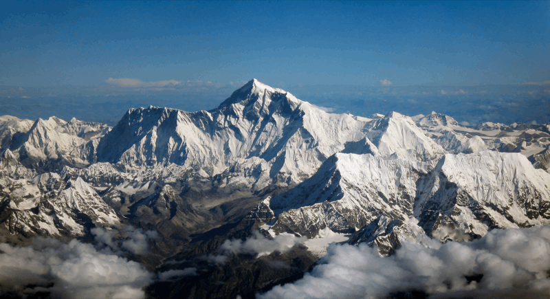

# OptiImg

🇬🇧 [English](README.md) · 🇻🇳 **Tiếng Việt**

**Nén cả một thư mục ảnh bằng một lệnh, chạy offline ngay trên máy bạn.**

OptiImg là công cụ nén ảnh chạy trên dòng lệnh. Gõ `optiimg` trong một thư mục, công cụ sẽ giảm dung lượng mọi ảnh PNG,
JPEG, WebP, AVIF và JPEG XL bên trong khoảng **70–80%** và ghi đè tại chỗ, mắt thường khó thấy khác biệt.
Không có ảnh nào bị gửi đi đâu.

## Kết quả thật

Cùng một ảnh, trước và sau khi chạy `optiimg` (PNG 800×435, không chỉnh gì khác):

| Ảnh gốc — **610 KB** | Sau OptiImg — **189 KB (−69%)** |
|---|---|
|  |  |

Ảnh đã nén dùng bảng 256 màu do bộ giảm màu của OptiImg tự chọn (SSIM 0,983, PSNR 39 dB so với ảnh gốc). Cả hai file nằm
trong [`docs/images/`](docs/images/) để bạn mở ở kích thước thật và so sánh.

Chạy trên 13 ảnh thử thật (ảnh chụp 4K và 8K, PNG màu log và 16-bit, một logo nền trong suốt), MacBook Apple Silicon:

```console
$ optiimg -y ./samples
Tìm thấy 13 ảnh (210.0 MB) trong ./samples
Dùng 4 worker.

[ 1/13]  4k.jpg         1.2 MB → 85 KB    (giảm 1.1 MB, -93%)   1.0s
[ 4/13]  4k_detail.png  16.8 MB → 3.7 MB  (giảm 13.1 MB, -78%)  2.7s
[ 8/13]  8k.jpg         26.6 MB → 6.0 MB  (giảm 20.6 MB, -77%)  5.8s
[10/13]  8k.png         92.1 MB → 22.2 MB (giảm 69.8 MB, -76%)  8.7s
  …
Xong: 13 đã nén, 0 đã tối ưu sẵn, 0 lỗi
Dung lượng: 210.0 MB → 43.3 MB  (đã giảm 166.6 MB, -79.4%)
Thời gian: 13s tổng (2.5s trung bình/ảnh, tổng thời gian từng ảnh 33s)
Chậm nhất: 8k.png (8.7s)
Bộ nhớ tiến trình đỉnh ≈ 1.8 GB
```

| Ảnh | Trước | Sau | Giảm | Thời gian |
|---|---|---|---|---|
| JPEG 4K nhiều chi tiết | 3,3 MB | 1,1 MB | 68% | 1,2 s |
| PNG 4K | 10,4 MB | 2,5 MB | 76% | 2,9 s |
| PNG 4K 16-bit | 32,7 MB | 3,0 MB | 91% | 2,0 s |
| JPEG 8K (50 MP) | 26,6 MB | 6,0 MB | 77% | 5,8 s |
| PNG 8K (50 MP) | 92,1 MB | 22,2 MB | 76% | 8,7 s |
| Logo PNG nền trong suốt | 11 KB | 4 KB | 67% | < 0,1 s |

Mức giảm tùy nội dung ảnh: bầu trời, mảng màu phẳng giảm rất nhiều; ảnh nhiều chi tiết giảm ít hơn.

## Tính năng

- **Offline, riêng tư.** Không server, không tài khoản, không upload. Một file chạy duy nhất cho macOS, Linux, Windows (amd64 và arm64).
- **Một lệnh cho cả thư mục.** Quét cả thư mục con, báo trước tìm thấy gì, hỏi xác nhận rồi mới động vào file.
- **Nén theo chất lượng, không theo một mức cố định.** Với từng ảnh, OptiImg tìm file nhỏ nhất mà vẫn đạt ngưỡng giống ảnh
  gốc (mặc định SSIM 0,98): ảnh đơn giản được nén mạnh, ảnh phức tạp được giữ chất lượng.
- **PNG:** giảm còn tối đa 256 màu bằng bộ giảm màu tự viết (median cut + k-means + dither), giữ độ trong suốt.
  `--max` ép thêm khoảng 9% bằng Zopfli.
- **JPEG:** mã hóa lại bằng jpegli (progressive, 4:2:0). Ảnh chụp từ điện thoại được xoay đúng chiều. Ảnh rất lớn dùng chế
  độ tiết kiệm bộ nhớ.
- **WebP, AVIF, JPEG XL:** cũng được nén tại chỗ, hoặc tạo từ ảnh PNG/JPEG bằng `--format`.
- **An toàn:**
  - không bao giờ ghi file lớn hơn file gốc;
  - ghi ra file tạm rồi mới đổi tên, nên mất điện hay bị tắt giữa chừng cũng không làm hỏng ảnh;
  - đánh dấu file đã xử lý, chạy lại không nén lần hai;
  - Ctrl+C một lần thì chờ các file đang làm xong, hai lần thì dừng ngay và không để lại file tạm.
- **Giữ đúng màu.** Profile màu dải rộng (ví dụ Display P3 từ iPhone) được giữ trong PNG/JPEG; metadata khác (EXIF, GPS,
  ảnh thu nhỏ) bị xóa để tiết kiệm dung lượng.
- **Nhẹ nhàng với máy.** Mặc định tối đa 4 worker, ngân sách bộ nhớ 2 GB, tự hạ độ ưu tiên tiến trình.
- **Báo cáo rõ ràng** bằng tiếng Việt hoặc tiếng Anh (`--lang en`): dung lượng trước/sau, số byte giảm và thời gian từng
  file, kèm tổng kết.

## Cài đặt

**Tải binary (khuyến nghị).** Vào trang **Releases** của repo, tải file đúng máy:

| Máy | File |
|---|---|
| Mac Apple Silicon (M1/M2/…) | `optiimg_<phiên bản>_darwin_arm64.tar.gz` |
| Mac Intel | `optiimg_<phiên bản>_darwin_amd64.tar.gz` |
| Linux | `optiimg_<phiên bản>_linux_amd64.tar.gz` hoặc `_arm64` |
| Windows | `optiimg_<phiên bản>_windows_amd64.zip` hoặc `_arm64` |

```sh
tar -xzf optiimg_*_darwin_arm64.tar.gz
sudo mv optiimg /usr/local/bin/      # hoặc thư mục bất kỳ trong PATH
optiimg --version
```

- **macOS:** binary chưa được ký. Nếu lần đầu chạy bị chặn:
  `xattr -d com.apple.quarantine /usr/local/bin/optiimg`.
- **Windows:** giải nén `optiimg.exe`, đặt vào một thư mục trong `PATH`.
- **Repo private:** cần đăng nhập GitHub; trên terminal có thể dùng `gh release download <tag> -p '*darwin_arm64*'`.
- Kiểm tra toàn vẹn (tùy chọn): `shasum -a 256 -c checksums.txt`.

**Hoặc build từ mã nguồn** (Go ≥ 1.27): `git clone https://github.com/vanh6803/OptiImg.git && cd OptiImg && make install`.

## Hướng dẫn sử dụng

> **Ảnh bị ghi đè tại chỗ và không hoàn tác được.** Xem trước bằng `optiimg -n` và sao lưu thư mục quan trọng trước lần
> chạy đầu.

```sh
optiimg                    # thư mục hiện tại và thư mục con: quét, hỏi xác nhận, nén
optiimg ~/Pictures/chuyen-di   # một thư mục khác
optiimg -n                 # chạy thử: liệt kê ảnh sẽ xử lý, không thay đổi gì
optiimg -y                 # không hỏi xác nhận (dùng trong script)
optiimg -y -j 2            # chỉ 2 worker: máy đỡ nặng
optiimg --lang en          # thông báo tiếng Anh (hoặc đặt OPTIIMG_LANG=en)
optiimg --format webp      # tạo file .webp cạnh mỗi ảnh PNG/JPEG (cũng có avif, jxl, jpg, png)
optiimg --max              # PNG: nhỏ thêm ~9% bằng Zopfli, chậm hơn nhiều
```

Quy trình an toàn cho lần đầu:

```sh
optiimg -n                       # 1. xem những file nào sẽ bị động vào
cp -R ./anh ./anh-backup         # 2. sao lưu
optiimg                          # 3. nén
```

### Các tùy chọn

| Tùy chọn | Tác dụng |
|---|---|
| `-y`, `--yes` | Bỏ qua câu hỏi `[y/N]`. Không có cờ này mà stdin không phải terminal thì OptiImg từ chối chạy. |
| `-n`, `--dry-run` | Liệt kê ảnh sẽ xử lý, không ghi gì. |
| `--no-recursive` | Chỉ thư mục chỉ định, không vào thư mục con. |
| `-j`, `--jobs N` | Số ảnh xử lý song song. Mặc định: một nửa số nhân CPU, tối đa 4. |
| `--max-mem MB` | Ngân sách bộ nhớ cho các ảnh chạy song song (mặc định 2048). Hạ xuống nếu máy ít RAM. |
| `--min-ssim S` | Ngưỡng chất lượng 0–1 (mặc định 0.98). Cao hơn = đẹp hơn, file lớn hơn. |
| `--lossless` | Không mất chất lượng (PNG giữ đủ màu; WebP/AVIF/JXL dùng chế độ lossless). |
| `--max` | PNG nhỏ hơn khoảng 9% bằng Zopfli, chậm hơn 10–100 lần. |
| `--format F` | Đổi sang `webp`, `avif`, `jxl`, `jpg` hoặc `png`. File mới được tạo cạnh file gốc; không bao giờ ghi đè file có sẵn, kết quả không nhỏ hơn thì không ghi. File gốc được giữ và đánh dấu đã xử lý. |
| `--delete-original` | Đi kèm `--format`: xóa file gốc sau khi tạo file mới thành công. |
| `--strip-icc` | Bỏ cả profile màu dải rộng (mặc định giữ để màu không bị lệch). |
| `--force` | Xử lý lại cả file đã được đánh dấu là đã nén. |
| `--keep-mtime` | Giữ nguyên thời gian sửa đổi của file. |
| `--include png,jpg` | Chỉ xử lý các đuôi này (mặc định: png, jpg, jpeg, webp, avif, jxl). |
| `--exclude MẪU` | Bỏ qua đường dẫn khớp mẫu, ví dụ `--exclude 'raw/*'` (dùng nhiều lần được). |
| `--lang vi\|en` | Ngôn ngữ thông báo (mặc định `vi`; hoặc `OPTIIMG_LANG=en`). |
| `--json` | Mỗi file một dòng JSON, dòng cuối là tổng kết, tiện cho script. |
| `-q`, `--quiet` | Chỉ in tổng kết cuối. |
| `--version` | In phiên bản. |

Mã thoát: `0` không có lỗi · `1` có ít nhất một file lỗi · `2` sai tùy chọn hoặc không xác nhận.

Tự động bỏ qua: thư mục ẩn (`.git`…), `node_modules`, `vendor`, symlink, file chỉ đọc, ảnh động, và file thuộc định dạng
OptiImg không hỗ trợ.

## Hạn chế

- **Định dạng:** chỉ PNG, JPEG, WebP, AVIF và JPEG XL. File RAW (CR2, DNG, ARW…), GIF, HEIC và ảnh động bị bỏ qua và giữ
  nguyên. WebP lossless cũng bị bỏ qua, vì bộ giải mã WebP đang dùng chuyển sang 4:2:0 nên nén lại sẽ làm ảnh xấu đi.
  JPEG XL động chưa nhận diện được, nên đừng chạy OptiImg trên thư mục có loại file này.
- **Đổi định dạng chủ yếu để tương thích.** Cùng ngưỡng chất lượng, file WebP/AVIF/JPEG XL trên ảnh thử của chúng tôi nằm
  trong khoảng nhỏ hơn 11% (JPEG XL) đến lớn hơn 6% (AVIF) so với JPEG do OptiImg nén; đừng kỳ vọng `--format` giảm thêm nhiều.
- **Tốc độ:** AVIF và JPEG XL mã hóa chậm hơn JPEG (ảnh 4K khoảng 6–9 giây, WebP khoảng 2 giây).
- **Bộ nhớ:** ảnh tối đa 100 megapixel. Ảnh 50 MP cần khoảng 0,9–1,3 GB RAM; máy ít RAM nên dùng `--max-mem` và `-j 1`.
  JPEG trên 16 MP dùng chế độ tiết kiệm bộ nhớ nên lớn hơn mức tối ưu 5–40%.
- **Profile màu** chỉ được giữ khi đầu ra là PNG hoặc JPEG; đổi sang WebP/AVIF/JPEG XL thì profile bị bỏ (báo
  `icc_profile_dropped` trong `--json`).
- **Dấu "đã nén"** lưu bằng thuộc tính mở rộng của file. Trên hệ thống file không hỗ trợ (một số ổ FAT/exFAT, ổ mạng),
  chạy lại có thể nén ảnh thêm lần nữa; OptiImg cảnh báo một lần. Các công cụ đồng bộ đám mây cũng có thể làm mất dấu.
- **Chỉ số chất lượng trong `--json`** của ảnh trên 4 MP là của mẫu dùng để dò chất lượng, không phải toàn ảnh.
- **Binary chưa ký:** macOS cần lệnh `xattr` ở trên trong lần chạy đầu.

Xem [CHANGELOG.md](CHANGELOG.md) để biết thay đổi của từng phiên bản.

Ảnh mẫu: "Mount Everest as seen from Drukair2" (Wikimedia Commons, CC BY-SA 2.0), đã thu nhỏ.
